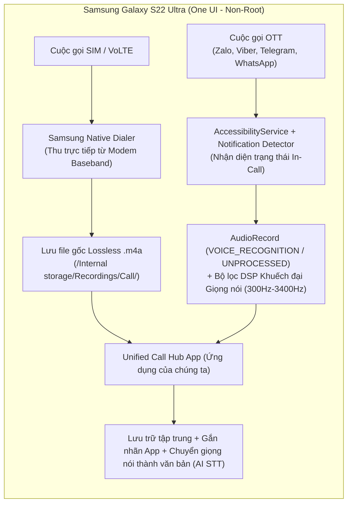

# Kiến Trúc Xây Dựng Ứng Dụng Ghi Âm Toàn Diện Cho Samsung Galaxy S22 Ultra

Tài liệu này thiết kế kiến trúc phần mềm chuyên biệt cho **Samsung Galaxy S22 Ultra** (One UI 6/7 - Android 14/15) nhằm giải quyết bài toán: **Gom toàn bộ bản ghi âm cuộc gọi SIM thông thường và cuộc gọi OTT (Zalo, Viber, Telegram, WhatsApp) vào một ứng dụng quản lý thống nhất**.

---

## 1. Kiến Trúc Lai (Hybrid Architecture) Tối Ưu Riêng Cho Samsung S22 Ultra (Không Root - Bảo Toàn Knox 0x0)

Thay vì dùng một cơ chế duy nhất cho cả hai loại cuộc gọi (vốn sẽ làm giảm chất lượng cuộc gọi SIM), ứng dụng trên S22 Ultra được thiết kế theo mô hình **Hybrid Dual-Engine**:

### 1.1. Luồng 1: Xử lý Cuộc gọi SIM thông thường (Chất lượng Tuyệt đối 100% 2 chiều)
- **Nguyên lý**: Trên Samsung S22 Ultra (mã vùng Việt Nam `XXV`), trình gọi điện gốc của Samsung có quyền hệ thống `CAPTURE_AUDIO_OUTPUT` thu trực tiếp từ chip Baseband cả 2 chiều (ngay cả khi dùng tai nghe Bluetooth) mà không phát tiếng thông báo.
- **Cách App hoạt động**:
  - App chạy một `FileObserver` / `ContentObserver` theo dõi thư mục `/storage/emulated/0/Recordings/Call/`.
  - Ngay khi cuộc gọi SIM kết thúc, App tự động nạp file `.m4a` vừa được Samsung tạo ra, trích xuất số điện thoại, thời lượng và đưa vào danh sách quản lý chung cùng với các cuộc gọi Zalo/Viber/Telegram/WhatsApp.
  - *Trường hợp máy S22 Ultra xách tay (Mỹ `U/U1`, Hàn `N`) chưa bật sẵn ghi âm gốc*: Đổi CSC sang `XXV` (trên máy Hàn/Quốc tế) hoặc dùng chung Engine Trợ năng của Luồng 2.

### 1.2. Luồng 2: Xử lý Cuộc gọi OTT (Zalo, Viber, Telegram, WhatsApp)
- **Nhận diện tự động cuộc gọi OTT (`OTTCallDetectorService`)**:
  - Kết hợp `AccessibilityService` (lắng nghe sự kiện `TYPE_WINDOW_STATE_CHANGED` và kiểm tra chế độ `AudioManager.MODE_IN_COMMUNICATION`) với `NotificationListenerService` để phát hiện chính xác khi người dùng bắt đầu nghe/gọi trên:
    - `com.zing.zalo` (Zalo)
    - `com.viber.voip` (Viber)
    - `org.telegram.messenger` (Telegram)
    - `com.whatsapp` (WhatsApp)
- **Thu âm và Xử lý Tín hiệu Số (`OTTAudioEngine`)**:
  - Vì S22 Ultra trang bị hệ thống **Loa thoại kép (Stereo Earpiece kiêm loa ngoài phía trên đỉnh máy)** nằm rất gần **Mic phụ chống ồn phía trên đỉnh máy**, khi gọi OTT:
  - App khởi tạo `AudioRecord` bên trong ngữ cảnh của `AccessibilityService` với nguồn `AudioSource.VOICE_RECOGNITION` (tắt bộ lọc triệt tiêu tiếng vọng AEC của hệ thống).
  - Áp dụng **Thuật toán Khuếch đại Thích ứng (Adaptive Dynamic Range Compression - DRC & Bandpass Filter 300Hz–3400Hz)**: Giữ nguyên âm lượng giọng nói của bạn (vốn rất to do nói sát Mic dưới) và **tự động kích âm lượng (Gain Boost +12dB đến +20dB)** cho các đoạn âm thanh nhỏ phát ra từ loa thoại của người bên kia nói.

---

## 2. Giới Hạn Thực Tế Cần Lưu Ý Trên S22 Ultra

| Kịch bản sử dụng trên S22 Ultra | Máy KHÔNG ROOT (Giữ Knox 0x0, dùng ngân hàng/Samsung Pay) | Máy ĐÃ ROOT (Magisk + LSPosed - Mất Knox 0x1) |
| :--- | :--- | :--- |
| **Gọi SIM thường (Loa trong / Loa ngoài / Tai nghe Bluetooth)** | **Thu rõ 100% cả 2 chiều** (Kết hợp trình ghi âm gốc của Samsung One UI). | **Thu rõ 100% cả 2 chiều**. |
| **Gọi Zalo, Viber, Telegram, WhatsApp (Áp tai nghe bình thường hoặc bật Loa ngoài)** | **Thu được cả 2 chiều** (Cần để âm lượng loa thoại từ 70–100% để Mic thu được âm thanh từ loa thoại kèm thuật toán khuếch đại DSP). | **Thu rõ 100% cả 2 chiều** (Thu trực tiếp luồng dữ liệu số nội bộ không phụ thuộc âm lượng loa). |
| **Gọi Zalo, Viber, Telegram, WhatsApp khi ĐEO TAI NGHE (Bluetooth / Type-C)** | **Chỉ thu được tiếng của bạn**, mất tiếng người bên kia (Do Android 10+ khóa luồng nội bộ `USAGE_VOICE_COMMUNICATION` và tai nghe không phát âm thanh ra ngoài không khí). | **Thu rõ 100% cả 2 chiều** (Nhờ module LSPosed mở khóa `AudioPlaybackCapture` hoặc hook `AudioFlinger`). |
